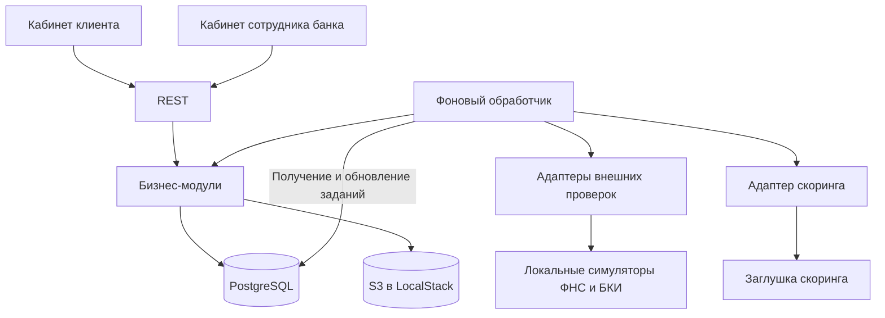
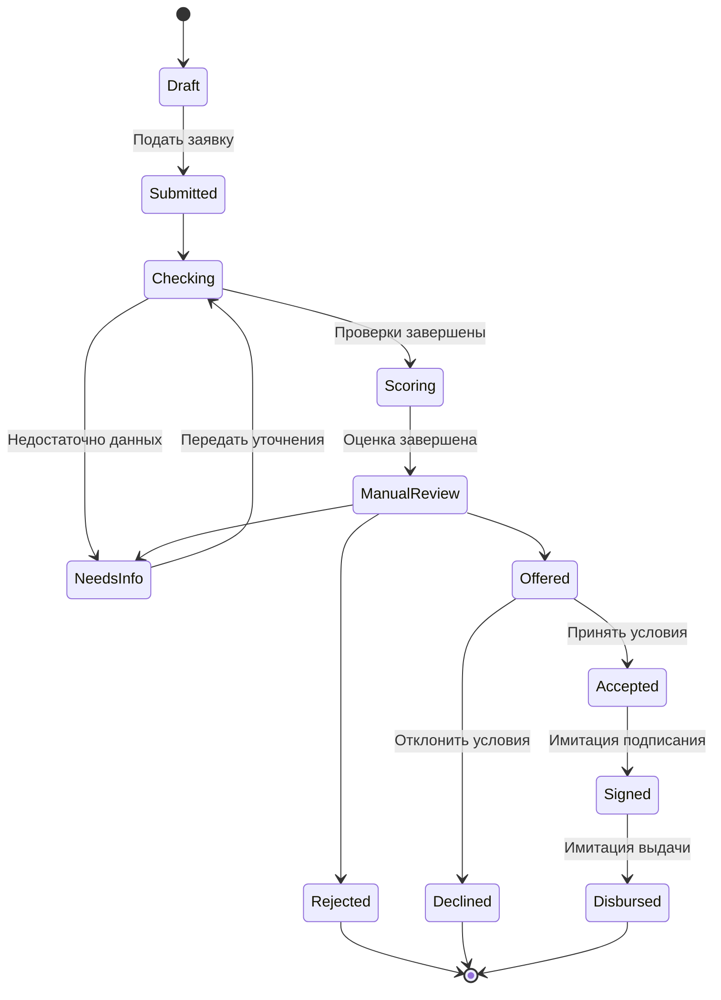

# Архитектура бэкенда

Стек:

- uv
- Python 3.14
- FastAPI
- sqlc для работы с SQL
- JWT HS256
- access token на 2 минуты
- refresh-сессия на 2 дня
- PostgreSQL 16
- S3 для хранения файлов; LocalStack для локального запуска

## 1. Цель и границы MVP

Бэкенд обеспечивает сквозной путь от создания заявки до результата рассмотрения, включая уточнение данных, автоматические проверки и участие сотрудника банка.

В MVP входят:

- Поддержка любых кредитных продуктов, описанных параметрами каталога, без фиксированного набора или числа продуктов. Ограничения суммы и срока, обязательные поля и документы задаются для каждого продукта данными каталога.
- Профиль компании и её представителей.
- Создание, сохранение и редактирование черновика заявки.
- Подача заявки с фиксацией снимка данных.
- Загрузка документов и запрос недостающей информации.
- Локальные заглушки проверок ФНС и БКИ без обращений к реальным сервисам.
- Заглушка скоринга через адаптер. Результат используется сотрудником при ручном рассмотрении.
- Только ручное рассмотрение: одобрение и отказ выполняются сотрудником банка.
- Одобрение, альтернативные условия, уточнение данных и отказ.
- Принятие предложения, имитация подписания и выдачи.
- История процесса и аудит действий.

## 2. Архитектурный подход

Модульный монолит с REST API и отдельный фоновый обработчик используют общую кодовую базу и PostgreSQL.

Worker напрямую обращается к PostgreSQL для получения и обновления фоновых заданий. Бизнес-операции он выполняет через модули: они управляют состоянием заявки и обращаются к PostgreSQL и S3. Доступ к файлам проходит через модуль документов.

SQL-запросы хранятся в SQL-файлах; для их вызова из Python используется код, сгенерированный sqlc. Схема БД управляется миграциями.

## 3. Бизнес-модули

| Модуль | Ответственность |
| --- | --- |
| Доступ | Аутентификация через JWT, роли, доступ к данным своей компании |
| Компании | Профиль бизнеса и членство представителей; уникальность ИНН |
| Продукты | Каталог, ограничения по сумме и сроку |
| Заявки | Черновик с финансовыми показателями, валидация, подача, версии и снимки данных |
| Документы | Загрузка и скачивание файлов через S3, метаданные, проверка прав доступа |
| Кредитный процесс | Этапы рассмотрения, допустимые переходы, запросы уточнений |
| Проверки | Адаптеры ФНС и БКИ, результаты, ошибки и повторные попытки |
| Интеграция скоринга | Подготовка входных данных, вызов заглушки через адаптер и сохранение результата |
| Кредитные решения | Фиксация ручного решения сотрудника и создание предложения условий |
| Аудит | История действий, изменений и основания решений |

### Заглушки внешних сервисов

Все внешние проверки выполняются только локальными заглушками. Подключение к реальным сервисам ФНС, БКИ и другим внешним источникам не входит в объём реализации. Не используются запросы к их сайтам или API, парсинг страниц и загрузка реальных реестров. Данные компаний, результаты проверок и документы для демонстрации - синтетические.

Адаптеры вызывают локальный `integration-mock`, который возвращает воспроизводимые результаты по подготовленным сценариям. Для проверки компании моделируются существование и статус бизнеса, совпадение или расхождение регистрационных данных, отметки о недостоверности и отсутствие компании в реестре. Отдельно моделируются техническая ошибка, таймаут и восстановление после повторной попытки. Отсутствие компании в ответе и недоступность источника - разные результаты.

Результаты заглушек сохраняются для ручного рассмотрения сотрудником.

## 4. Состояния заявки

Сбой интеграции хранится в состоянии конкретной проверки и не считается отказом по кредиту. Пока обязательная проверка не завершена, одобрение недоступно. После исчерпания повторных попыток требуется явное действие сотрудника для восстановления обработки.

## 5. Обработка заявки

Подача выполняется в одной транзакции PostgreSQL:

1. Проверить права, состояние черновика и полноту данных.
2. Зафиксировать неизменяемый снимок данных заявки.
3. Перевести заявку в `Submitted` и записать событие.
4. Создать задание на обработку.

Фоновый обработчик забирает задания через `FOR UPDATE SKIP LOCKED`. Захват задания выполняется короткой транзакцией; внешние вызовы выполняются после её завершения. Задание имеет срок блокировки, число попыток и время следующего запуска. После сбоя обработчика просроченное задание можно захватить повторно.

Проверки и скоринг выполняются отдельными фоновыми шагами. После успешного скоринга worker переводит заявку в `ManualReview`; автоматически одобрять заявку или отказывать нельзя. Результат шага, переход состояния и создание следующего задания сохраняются атомарно. Ручное решение и предложение сохраняются в транзакции по команде сотрудника.

Уточнение данных создаёт новую версию снимка. Проверки и оценки связаны с конкретным снимком; результаты предыдущей версии не используются автоматически для принятия решения по изменённым данным.

### Надёжность и конкурентные изменения

- Доставка фоновых заданий допускает повторное выполнение. Каждый шаг должен быть идемпотентным.
- Поле `version` и условное обновление защищают от конкурирующих изменений клиента, сотрудника и обработчика.
- Правила повторов различают временную техническую ошибку и содержательный результат проверки.
- Таймауты, число повторов и задержки задаются конфигурацией.

## 6. Скоринг, решение и предложение

Это отдельные сущности с разной ответственностью:

- `ScoringResult` содержит оценку риска, факторы и версию модели или правил скоринга.
- `CreditDecision` содержит ручное решение сотрудника, основания, версию политики и автора решения; `source` всегда `manual`.
- `Offer` содержит конкретные сумму, срок, ставку и условия, которые принимает клиент.

Одинаковая оценка риска может приводить к разным решениям в зависимости от продукта, суммы, срока и результатов проверок. Одобрение и отказ принимает только сотрудник банка в рамках разрешённых действий. Скоринг не создаёт кредитное решение автоматически.

Разделение клиентского представления решения и внутренних банковских данных, а также формат предложения описаны в [контракте API](openapi.yaml).

### Граница ответственности за скоринг

Бэкенд отвечает за подготовку данных, запуск оценки через адаптер, сохранение результата и дальнейшее выполнение кредитного процесса. Бэкенд фиксирует решение сотрудника и проверяет допустимость действия и условий предложения.

Используется детерминированная заглушка скоринга. Её контракт включает:

- Вход: идентификатор запроса, идентификатор снимка, версия схемы, параметры продукта и заявки, финансовые показатели и результаты проверок.
- Выход: идентификаторы запроса и снимка, версия модели, оценка риска с описанием шкалы, факторы или коды причин результата.
- Отдельные ответы для недостаточности данных и технической ошибки. Они не считаются отрицательным кредитным решением.
- Повторный вызов с тем же идентификатором запроса и теми же данными должен безопасно обрабатываться; политика повторного расчёта и воспроизводимости согласуется явно.

Заглушка возвращает синтетический `ScoringResult`, явно помеченный версией модели `stub-v1`.

Основания ручных решений и демонстрационные допущения документируются отдельно. Заглушка скоринга запускается локально без платных зависимостей; подключение реального внешнего скорингового сервиса не входит в объём реализации.

## 7. Основные сущности

| Сущность | Назначение |
| --- | --- |
| `User` | Пользователь системы |
| `AuthSession` | Сессия пользователя и её отзыв |
| `RefreshToken` | Токен сессии и история ротации |
| `Company` | Профиль бизнеса |
| `CompanyMember` | Связь пользователя с компанией и его полномочия |
| `LoanProduct` | Продукт и его ограничения |
| `Application` | Заявка, текущее состояние и версия |
| `ApplicationSnapshot` | Неизменяемая версия данных для рассмотрения |
| `Document` | Метаданные, S3 bucket и ключ объекта, привязка к заявке или версии |
| `InformationRequest` | Запрос уточнений и ответ клиента |
| `CheckRun` | Попытка проверки, источник, результат и техническая ошибка |
| `ScoringResult` | Оценка риска по конкретному снимку |
| `CreditDecision` | Решение и его основания |
| `Offer` | Предложенные условия и результат их принятия |
| `ApplicationEvent` | История бизнес-переходов заявки |
| `AuditEvent` | Аудит действий пользователей и системы |
| `Job` | Фоновое задание и состояние его выполнения |

Денежные значения хранятся точным числовым типом с явной валютой. Время хранится в UTC. Детальная модель таблиц, связей и ограничений будет описана отдельно.

### Хранение документов

Содержимое файлов хранится в S3; для локального запуска и демонстрации используем эмуляцию S3 в LocalStack. PostgreSQL хранит метаданные документа и его расположение: bucket и ключ объекта. Эти параметры используются только бэкендом и не добавляются в публичный ответ `Document`.

Загрузка проходит через FastAPI: сервер проверяет права, размер и тип файла, генерирует уникальный ключ объекта и сохраняет файл в S3. При скачивании сервер проверяет доступ к заявке и документу и передаёт содержимое из S3 клиенту. Bucket закрыт для публичного доступа; реквизиты хранилища доступны только серверным компонентам. Существующие маршруты API документов сохраняются.

Файлы неизменяемы: замена документа создаёт новый объект с новым ключом и новую запись метаданных. Объекты, включённые в снимки заявки, нельзя перезаписывать или удалять через пользовательские операции.

Запись в S3 и транзакция PostgreSQL не являются одной атомарной операцией. Метаданные доступного документа фиксируются после успешной загрузки; объекты, оставшиеся без записи в БД после сбоя, удаляются отдельной процедурой очистки.

## 8. REST API

[openapi.yaml](openapi.yaml) — источник описания HTTP-контракта: маршрутов, параметров, прав на операции, схем запросов и ответов, ошибок, пагинации и примеров. Эти сведения здесь не дублируются. Для обновления состояния на фронтенде достаточно периодического опроса API.

## 9. Доступ, аудит и эксплуатация

- Сервер проверяет подпись, срок действия и ожидаемые параметры access JWT. Алгоритм и сроки токенов зафиксированы в стеке; способ передачи токена описан в OpenAPI.
- JWT идентифицирует пользователя. Права на компанию, заявку и банковские действия проверяются сервером, а не принимаются из данных запроса.
- Вход создаёт сессию и выдаёт access JWT и refresh token. Предлагаемый refresh token - непрозрачная случайная строка; в PostgreSQL хранится только хеш. Access JWT содержит `sid`, активность сессии проверяется на защищённых запросах.
- Ротация атомарно погашает refresh token и создаёт новый. История хешей погашенных токенов сохраняется до истечения сессии. Повторное использование отзывает всю сессию; неизвестный, истёкший или отозванный токен не позволяет обновить доступ. Права для нового access JWT читаются из актуальных данных пользователя.
- Клиент выполняет только один refresh одновременно. После неопределённого сетевого результата автоматический повтор не применяется, поскольку погашенный токен приведёт к отзыву сессии; требуется повторный вход.
- Выход отзывает одну сессию, включая её access JWT. Повторный выход безопасен. Остальные сессии пользователя остаются активными. Ротация и отзыв синхронизируются атомарно.
- Сессия имеет абсолютный срок жизни с момента входа, который ротация не продлевает. При ротации новый refresh token действует до исходного окончания сессии. Хранение секрета HS256 и безопасное хранение токенов на фронтенде предстоит определить. Вне локальной разработки токены передаются только по HTTPS.
- При каждом обращении к объекту сервер проверяет полномочия пользователя; отображаемые фронтендом действия не заменяют эту проверку.
- Роли и правила доступа к операциям определены в OpenAPI. Их проверка централизована в модуле доступа.
- Аудит фиксирует участника, время, действие, объект и результат. Пароли, токены и содержимое документов не попадают в журналы.
- API и worker пишут структурированные логи с идентификаторами запроса, заявки и задания.
- Предусматриваются проверки работоспособности и готовности, а также наблюдение за ошибками проверок, повторами и просроченными заданиями.
- Секреты и параметры окружения передаются через конфигурацию; демонстрационные учётные записи явно документируются.

## 10. Развёртывание

Docker Compose поднимает:

- `api` - HTTP API;
- `worker` - фоновую обработку;
- `postgres` - данные и очередь заданий;
- `localstack` - эмуляция S3 для хранения файлов;
- `integration-mock` - локальные заглушки ФНС, БКИ и других моделируемых внешних источников; реальные сервисы не вызываются.

## 11. Сценарии проверки

Синтетические данные должны позволять воспроизвести:

1. Прохождение заглушек проверок и скоринга, ручное одобрение, принятие условий, имитацию подписания и выдачи.
2. Предложение альтернативной суммы или срока.
3. Запрос уточнений, ответ клиента и повторное рассмотрение.
4. Передачу сотруднику и ручное решение.
5. Ручной отказ с сохранением автора и основания решения; отсутствие автоматического одобрения и отказа.
6. Временный сбой внешней проверки и успешную повторную попытку.
7. Отклонение повторной команды подачи уже отправленной заявки по версии или состоянию без повторного запуска обработки.
8. Конкурирующие изменения и запрет доступа к чужим данным.
9. Перезапуск worker с восстановлением незавершённой обработки.
10. Обновление пары токенов, обнаружение повторного использования refresh token, истечение сессии и отказ доступа после выхода.
